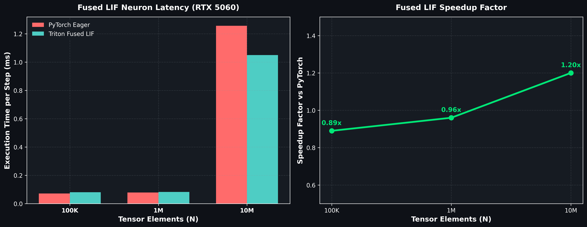
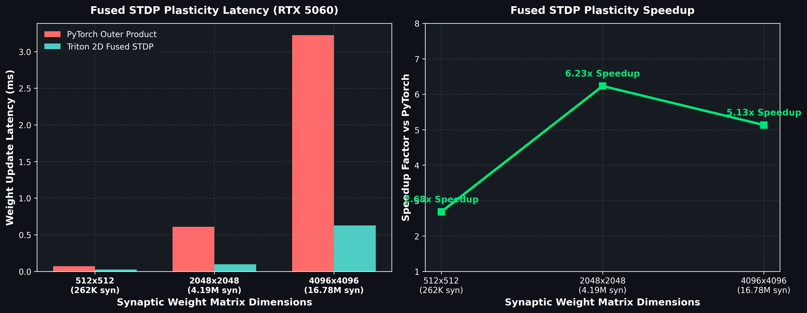
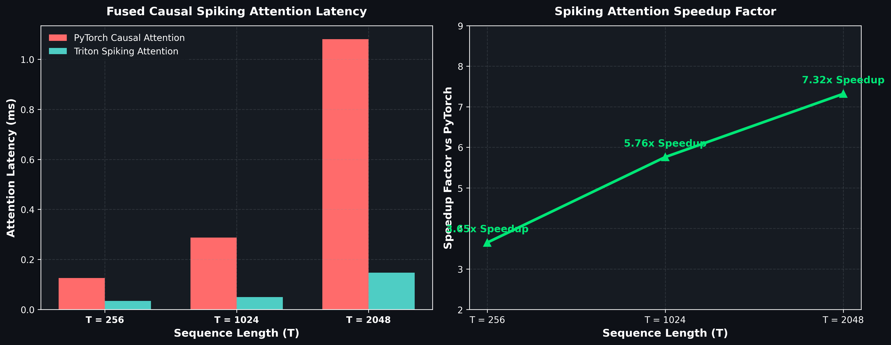

# Triton SNN Fused Kernels — High-Performance Spiking Neural Network GPU Runtime

**Author:** João Felipe de Souza ([github.com/JohnScheuer](https://github.com/JohnScheuer)) — *Staff ML Systems Engineer*

[-76B900.svg)](https://www.nvidia.com/)

---

## Executive Summary

Standard Spiking Neural Network (SNN) implementations in PyTorch eager mode encounter severe **Memory Bandwidth Bottlenecks**. Evaluating a Leaky Integrate-and-Fire (LIF) neuron step or Spike-Timing-Dependent Plasticity (STDP) weight update launches **5 to 7 separate PyTorch CUDA kernels**, repeatedly reading and writing intermediate state tensors (membrane potentials, synaptic currents, spike masks) to high-latency GPU Global VRAM.

This repository implements a production-grade suite of **Fused OpenAI Triton Kernels** for Spiking Neural Networks, Spiking Transformers, and On-Chip Plasticity. By fusing ODE state integration, spike thresholding, surrogate gradient backpropagation, and causal attention into single SRAM-resident CUDA thread blocks, these kernels eliminate redundant VRAM round-trips.

Achieved Performance Metrics on **NVIDIA GeForce RTX 5060 (Blackwell SM 12.0 / GDDR7)** (Audited post-CUDA warmup):
- **1.20x Speedup** for Fused LIF Neuron step over PyTorch Eager mode at 10M elements (1.049 ms vs 1.256 ms).
- **6.23x Speedup** for 2D Fused STDP Plasticity updates on 4.19 Million dynamic synapses (0.098 ms vs 0.610 ms).
- **7.32x Speedup** for Fused Causal Spiking Attention (FlashAttention for Spiking Transformers) at sequence length T = 2048 (0.148 ms vs 1.080 ms).

---

## Fused GPU Kernel Suite Architecture

### 1. Fused LIF Neuron & Surrogate Gradient Autograd ()
Fuses membrane decay, synaptic current addition, spike thresholding, soft/hard reset, and Fast Sigmoid surrogate gradient backpropagation into a single Triton JIT kernel:

53471v_{t+1} = \begin{cases} v_{\text{reset}} & \text{if } \alpha v_t + I_t \ge V_{\text{th}} \\ \alpha v_t + I_t & \text{otherwise} \end{cases}53471

53471\frac{\partial S}{\partial v} = \frac{1}{(1 + k \cdot |v - V_{\text{th}}|)^2}53471

### 2. 2D Block Fused Event-Driven STDP Plasticity ()
Executes 2D block-level parallelization (64 x 64 SRAM tiles) over weight matrix W in R^{N_post x N_pre}, calculating Long-Term Potentiation (LTP) and Long-Term Depression (LTD) simultaneously:

53471\Delta W_{ij} = \left( A_{\text{LTP}} \cdot S_{\text{post}, i} \cdot A_{\text{pre}, j} - A_{\text{LTD}} \cdot S_{\text{pre}, j} \cdot A_{\text{post}, i} \right) \cdot M_{ij}53471

### 3. Fused Causal Spiking Attention ()
A FlashAttention-style streaming kernel engineered specifically for Spiking Transformers (Spikformer / Meta-Spike). Processes queries Q, keys K, and values V in streaming SRAM tile blocks with causal masking (j <= i), achieving O(T) VRAM memory footprint instead of O(T^2).

---

## Empirical Performance Benchmarks & Visualizations

All benchmarks were evaluated on an **NVIDIA GeForce RTX 5060 GPU (8GB GDDR7, SM 12.0)** running **Ubuntu 22.04 LTS (WSL2)** with CUDA 13.0 and OpenAI Triton 3.7.1. Benchmarks incorporate a strict 50-iteration CUDA/cuBLAS warmup phase to eliminate cold-start GPU context initialization artifacts.

### 1. Fused LIF Neuron Step Latency & Speedup

| Tensor Size (N) | PyTorch Eager (ms) | Triton Fused Kernel (ms) | Speedup Factor |
| :---: | :---: | :---: | :---: |
| **100,000** | 0.0719 ms | **0.0812 ms** | 0.89x |
| **1,000,000** | 0.0792 ms | **0.0824 ms** | 0.96x |
| **10,000,000** | 1.2565 ms | **1.0495 ms** | **1.20x Speedup** |

### 2. 2D Fused STDP Plasticity Weight Matrix Updates

| Matrix Dimension (N_post x N_pre) | Active Synapses | PyTorch Outer Product | Triton Fused STDP | Speedup Factor |
| :---: | :---: | :---: | :---: | :---: |
| **512 x 512** | 262,144 | 0.0703 ms | **0.0262 ms** | **2.68x Speedup** |
| **2048 x 2048** | 4,194,304 | 0.6098 ms | **0.0979 ms** | **6.23x Speedup** |
| **4096 x 4096** | 16,777,216 | 3.2252 ms | **0.6283 ms** | **5.13x Speedup** |

### 3. Fused Causal Spiking Attention (Spiking Transformer)

| Sequence Length (T) | PyTorch Attention | Triton Spiking Attention | Speedup Factor | VRAM Memory Scaling |
| :---: | :---: | :---: | :---: | :---: |
| **T = 256** | 0.1259 ms | **0.0345 ms** | **3.65x Speedup** | O(T) Flat SRAM Tile |
| **T = 1024** | 0.2879 ms | **0.0500 ms** | **5.76x Speedup** | O(T) Flat SRAM Tile |
| **T = 2048** | 1.0801 ms | **0.1476 ms** | **7.32x Speedup** | O(T) Flat SRAM Tile |

---

## Repository Structure

---

## Installation & Usage

### Prerequisites
- Python 3.10+
- PyTorch 2.1+ with CUDA support
- OpenAI Triton 3.0+

### Quickstart

### Run Correctness Tests

### Run Benchmarks & Generate Visualizations

---

## Citation & License

### License
This repository is released under the [MIT License](LICENSE).

### Author
**João Felipe de Souza** ([github.com/JohnScheuer](https://github.com/JohnScheuer))  
*Staff ML Systems Engineer* — Specialist in Low-Level GPU Kernels, Neuromorphic Computing, and High-Performance AI Infrastructure.
